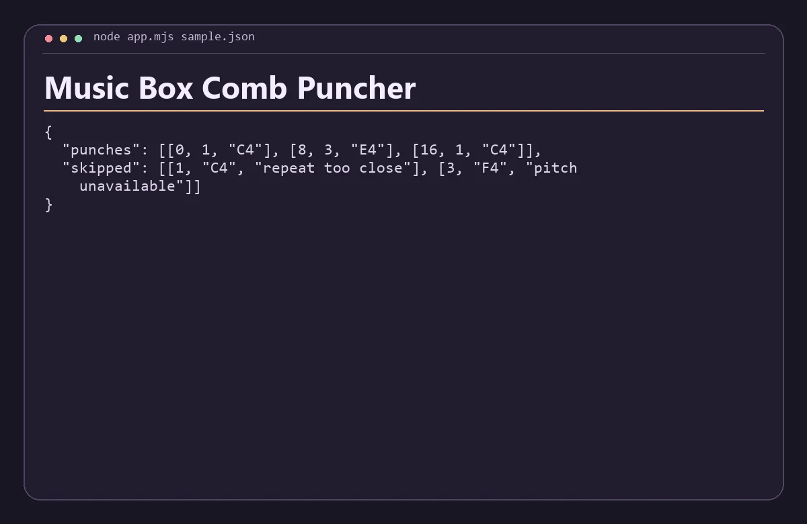

# Music Box Comb Puncher

Turn a timed melody into paper-strip punch coordinates and flag pitches the comb cannot play or repeat in time.



## Run

Install Node.js 22 or newer. Run these commands from the repository root.

```sh
node app.mjs sample.json
```

Replace `sample.json` with a JSON file following the same structure. The app prints a JSON report to standard output.

Time is measured in beats from strip start. A punch is [distance in mm, one-based comb track, pitch]. Events at the same time may form chords. A rejected punch does not reset the repeat distance.

## Verify

Run `python check.py` with Python 3.11 or newer after the build step when applicable. The check verifies the bundled scenario and confirms that an invalid input returns an error.
